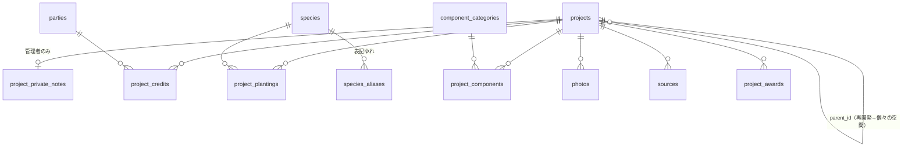

# DB設計（v0 / 2026-10-17）

スキーマ本体: [`supabase/migrations/20261017000000_initial_schema.sql`](../supabase/migrations/20261017000000_initial_schema.sql)
構成要素の一般分類（初期値）: [`supabase/seed.sql`](../supabase/seed.sql)

## 決めたこと

| 論点 | 決定 |
|---|---|
| 面的プロジェクト | 同じ `projects` に `parent_id`。樹種・素材は子（個々の空間）に紐づける |
| 設計者・施工者・施主 | `parties` + `project_credits(role)`。設計者ページは `parties.slug` から生成 |
| 樹種 | `species`（学名 unique、YList ID）+ `species_aliases`（欅・けやき等）。植栽は必ずマスタ経由 |
| 素材・ファニチャー等 | `component_categories`（一般分類・必須）+ `product_name` / `maker_name`（任意文字列）。tecture型に進む時点でメーカーマスタへ移行 |
| 非公開層 | `project_private_notes`。RLS で管理者のみ |
| 写真 | 自分で撮影したものだけ。`exif_stripped` と `people_checked` が両方 true でないと公開側から見えない |
| 2言語 | 名称・キャプション・分類に `_en`。本文英訳は `summary_en_status`（none → machine_draft → reviewed）。reviewed になるまで英語ページでは本文を出さない |
| 公開制御 | `projects.status = 'published'` の物件とその子データだけ匿名で読める |
| slug | 英小文字・数字・ハイフン。URL は `/ja/projects/{slug}` `/en/projects/{slug}` を想定 |

## 樹種マスタの初期データ

- [`supabase/seed_species.sql`](../supabase/seed_species.sql)：ランドスケープでよく使う 101 種と表記ゆれ 186 件
- 生成元：[`scripts/build_species_seed.py`](../scripts/build_species_seed.py)。YList（2021-05-14版のタブ区切りデータ）の「標準」行から学名・科名・YList ID を引く
- YList に載っていない栽培種（ハナミズキ、ジューンベリー）は、スクリプト内の `MANUAL` に学名を手入力している
- YList の明示的な利用条件（再配布・商用利用）はサイト上に見当たらない。データは「暫定公開」扱い。そのため YList 本体はリポジトリに入れず、使う種だけを出典付きで seed にしている。公開前に作成者（米倉浩司氏）へ利用の可否を確認する

## 未検証・後で決めること

- 2026-10-17：Supabase にスキーマと seed を適用し、[`scripts/apply_and_verify.py`](../scripts/apply_and_verify.py) の 13 項目がすべて通過。検証項目は、拡張、13 テーブル、全テーブルの RLS、seed の件数、表記ゆれ検索、匿名ロールの閲覧範囲（公開物件のみ／非公開メモ不可／人物確認済み写真のみ／書き込み拒否）、PostGIS の距離計算。検証用データはロールバック済み
- 本番用プロジェクトは ap-northeast-1（東京）。同日に東京へ適用し、13 項目すべて通過。最初に作ったムンバイ（ap-south-1）のプロジェクトは不要
- 樹種の追加は `CURATED` / `MANUAL` に足して seed を再生成する
- 写真の Storage バケット設計とアップロード時の EXIF 削除処理（Next.js の管理画面側で実装）
- 都道府県は当面テキスト。全国展開時にコード化を検討
